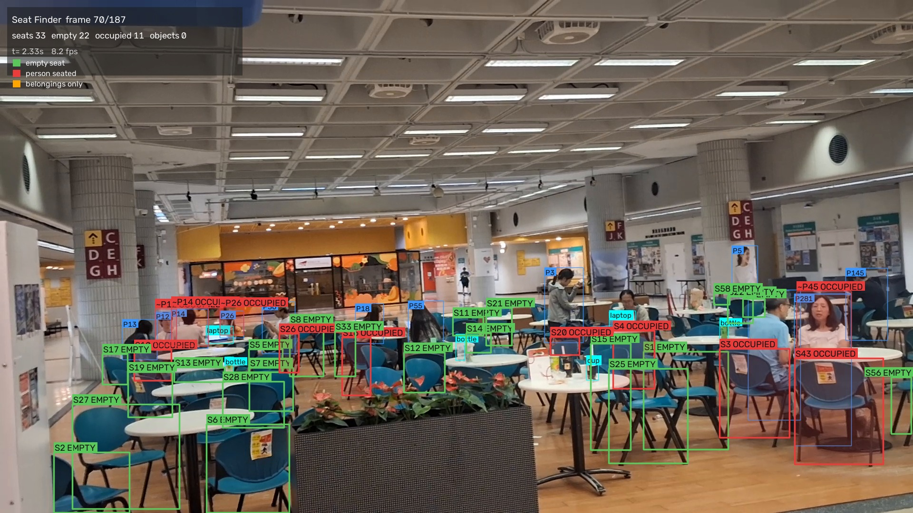
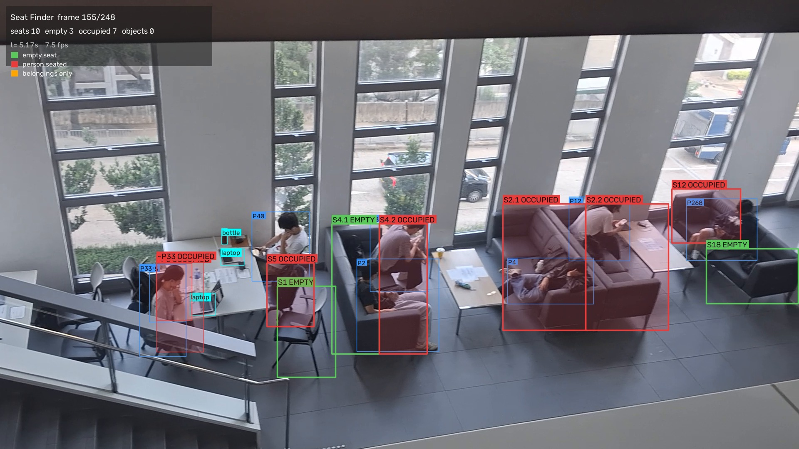
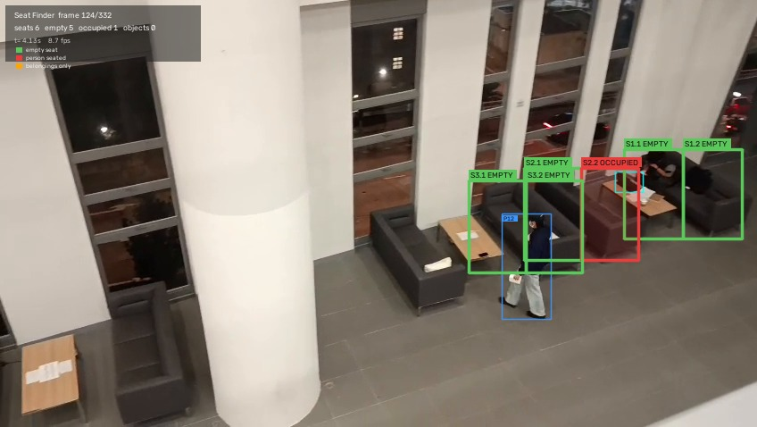

# Seat Finder

A locally-runnable prototype that watches a video of a study area and labels
every seat as **empty**, **occupied**, or **occupied with objects** ("ghost
occupancy"). It writes an annotated video, per-seat CSV, per-video JSON and a
few annotated stills.

No seat map, polygon or ROI file is required: the seat inventory is inferred
from what the detector sees.

```
data/*.mp4  ->  YOLO detections  ->  seat inventory  ->  per-seat state  ->  annotated video + CSV/JSON
```

---

## At a glance

| Item | Value |
| --- | --- |
| Input | video files (`.mp4`, `.mov`, `.avi`, `.mkv`); a folder is processed in one run |
| Output | annotated `.mp4`, annotated `.jpg` stills, `seats.csv`, `frames.csv`, `json/<video>.json`, `summary.json` |
| Model | Ultralytics YOLOv10s (COCO weights, auto-downloaded on first run) |
| Runtime | Python 3.15.1 + `.venv`, CPU ~8 fps at `imgsz=1280` (GPU optional, see below) |
| States | `empty`, `occupied`, `ghost` |
| Tests | 50 unit/integration tests, no model needed |

---

## Quick start

```powershell
# from the project root (D:\dsh_work\GE2340AI); "python" must be 3.15.1
python -m venv .venv
.venv\Scripts\python -m pip install -r requirements.txt

# one clip
.venv\Scripts\python -m seatfinder --input "data\VID-20261118-WA0000.mp4" --output runs\demo

# the whole folder
.venv\Scripts\python -m seatfinder --input data --output runs\demo
```

The first run downloads `yolov10s.pt` (~16 MB) from the Ultralytics release
page. No other network access is needed.

### Useful options

| Option | Default | Meaning |
| --- | --- | --- |
| `--input` | required | video file or directory |
| `--output` | `runs/latest` | output directory |
| `--weights` | `yolov10s.pt` | YOLO weights, including your own fine-tuned `best.pt` |
| `--imgsz` | `1280` | inference resolution; 960 is ~1.5x faster, 1280 detects small chairs better |
| `--conf` | `0.25` | confidence for people, furniture and tables |
| `--belonging-conf` | `0.15` | separate, lower floor for bags/laptops/cups |
| `--device` | auto | `cpu` or a CUDA index such as `0` |
| `--stride` | `1` | process every Nth frame (faster, output fps follows) |
| `--max-frames` | none | stop each video early |
| `--limit` | none | process only the first N videos |
| `--stills` | `4` | annotated stills per video (`0` disables) |
| `--no-video` | off | skip rendering, write only CSV/JSON |
| `--no-inferred` | off | disable seats inferred from seated people |

---

## Outputs

```
runs/demo/
├─ annotated/   <video>_annotated.mp4     overlay: seat boxes, states, counts
├─ stills/      <video>_<frame>.jpg       evenly spaced annotated frames
├─ json/        <video>.json              per-seat timelines and occupancy stats
├─ seats.csv                              one row per seat per frame
├─ frames.csv                             one row per frame (counts)
└─ summary.json                           all videos + run metadata
```

`seats.csv` columns:

| Column | Meaning |
| --- | --- |
| `video`, `frame`, `time_s` | source clip and position |
| `seat_id`, `cell`, `kind` | seat unit, sub-seat (couches only), `chair`/`couch`/`bench`/`inferred` |
| `state` | `empty`, `occupied`, `ghost` |
| `person_id` | tracker id currently on the seat, if any |
| `objects` | objects assigned to the seat, `|`-separated |
| `x1..y2` | seat cell box in pixels |

`json/<video>.json` contains, per seat, the time spent in each state and the
state-transition timeline, plus mean/peak counts and an occupancy rate.

---

## How it works

The four stages of the project plan map onto the package like this.

### 1. Acquisition and pre-processing (`video_io.py`, `pipeline.py`)

Frames are decoded with OpenCV; `--stride` can drop frames to go faster. The
frame is handed to the detector at `--imgsz` resolution and all coordinates are
mapped back to the original frame size, so a 1080p and a 480p clip are treated
the same way.

### 2. Model processing (`detector.py`)

One YOLOv10 forward pass per frame returns people, furniture and belongings.
COCO is used as the pre-trained label set:

| Role | COCO classes |
| --- | --- |
| person | `person` |
| seat | `chair`, `couch`, `bench` |
| belongings | `backpack`, `handbag`, `suitcase`, `umbrella`, `laptop`, `bottle`, `cup`, `keyboard`, `mouse`, `cell phone` |
| context | `dining table` |

People, furniture and tables use `--conf`; belongings use the lower
`--belonging-conf` because small bags on dark chairs score poorly.
ByteTrack (`ultralytics` tracker) supplies stable ids for people, which is what
lets the noise filter tell a sitting person from a passer-by.

### 3. Data mapping: seats without an ROI (`tracking.py`, `association.py`)

There is no seat map. Each frame's furniture detections become **seat units**:

* a chair is one seat unit; a couch or bench is split into equal seat cells,
  with the count estimated from the typical person width in the frame;
* units are matched frame to frame by IoU, with a centre-distance fallback, so
  a seat keeps its id while the camera moves;
* a new detection must persist for `confirm_hits` frames before it becomes a
  seat, which removes one-frame hallucinations;
* a seat survives `ttl_frames` without being detected, because someone sitting
  down hides the chair behind them.

Most seats are hidden by the person using them, so a person with no seat is
also a seat: if they stay still for `min_still_seconds`, look seated (aspect
ratio below 2.3) and are near furniture, the pipeline registers an **inferred
seat** for them (`~P<id>` in the video). This is what recovers occupied chairs
that the detector never sees.

A person is assigned to a seat cell with a score that combines IoU with a
"their feet are inside this seat" test, because a seated person's box is much
taller than the chair. A cell takes at most one person.

A belonging counts as left on a seat when it is substantially inside a cell
(70% of its area), its centre is inside the cell, it sits below the top 30% of
the seat box, is not carried by a person, and is not implausibly large.
That deliberately rejects items on a table that a loose couch box overlaps.

### 4. Noise filtering (`tracking.py`, `state.py`)

The plan asks for a metric to filter passers-by. Four filters are applied:

1. **Motion relative to the scene.** `GlobalMotion` estimates camera movement
   as the median displacement of tracked people and subtracts it, so stillness
   works on handheld footage. With fewer than three people the median would be
   one person's own walking, so compensation is disabled.
2. **Stillness.** A person must hold position within 1.5% of the frame width for
   0.6 s before an inferred seat is created.
3. **Evidence hysteresis.** A seat changes state only after `confirm_frames`
   consecutive frames (5 for ghost, since bags are static), and needs
   `release_frames` to return to empty. A single dropped detection costs one
   unit of evidence instead of resetting it.
4. **Object memory.** Belongings flicker in and out of the detector; a sighting
   stays valid for `object_memory_frames` so ghost occupancy can accumulate.

### 5. Rendering and reporting (`renderer.py`, `summary.py`)

Green = empty, red = occupied, amber = belongings only. The HUD shows live
counts; inferred seats are drawn with a thin box and a `~P` label.

---

## The three states

| State | Display | Decided when |
| --- | --- | --- |
| Empty | green | no person assigned and no belonging on the seat |
| Occupied | red | a person is assigned, or an inferred seat exists |
| Occupied with objects | amber | no person, but a belonging is assigned to the seat |

"Occupied with objects" is the *ghost occupancy* case the project targets: a
backpack or laptop holding a seat while its owner is elsewhere.

---

## Results on `./data`

The eight clips were processed with the default settings (`yolov10s.pt`,
`imgsz=1280`, CPU). Whole run: 2,356 frames in 292 s, about 8 fps.

| Clip | Scene | Frames | Seats | Empty | Occupied | Objects | Occupancy |
| --- | --- | ---: | ---: | ---: | ---: | ---: | ---: |
| `20261026_154828.mp4` | lounge with sofas, fixed camera | 248 | 8.7 | 3.4 | 5.3 | 0.0 | 61% |
| `20261026_222134.mp4` | canteen, 1080p, fixed | 187 | 28.1 | 19.4 | 8.7 | 0.0 | 31% |
| `20261113_084813.mp4` | canteen, handheld and blurred | 486 | 4.2 | 4.2 | 0.0 | 0.0 | 0% |
| `VID-20261113-WA0002.mp4` | outdoor terrace, daytime | 228 | 8.9 | 7.6 | 1.3 | 0.0 | 15% |
| `VID-20261118-WA0000.mp4` | canteen, 480p | 270 | 20.5 | 14.5 | 6.1 | 0.0 | 30% |
| `VID-20261118-WA0006.mp4` | bar counter, chairs empty | 315 | 6.1 | 6.1 | 0.0 | 0.0 | 0% |
| `Video Project.mp4` | outdoor terrace, night | 290 | 8.0 | 5.8 | 2.3 | 0.0 | 28% |
| `WhatsApp Video …20.49.28.mp4` | lounge with sofas, night | 332 | 6.1 | 4.9 | 1.2 | 0.0 | 20% |

"Seats / empty / occupied / objects" are frame averages; occupancy is mean
occupied seats divided by mean tracked seats.


*Canteen clip: 33 seats tracked, 22 empty, 11 occupied.*


*Sofas are split into seat cells; `~P33` is a seat inferred from a person whose
chair was never detected.*


*Night lounge. The person walking past is tracked (`P7`) but does not create a
seat.*

### What the numbers say

* **Empty vs occupied works.** The canteen clip tracks 28 seats on average and
  separates 19 empty from 9 occupied; the empty bar counter reports every seat
  empty, which is correct.
* **Sofas need splitting.** The lounge clip has only four sofas in view, yet
  the inventory is 8.7 seats because each couch is divided into two cells.
* **Handheld blur hurts.** `20261113_084813.mp4` is a fast pan with heavy
  motion blur; the detector finds 4 chairs in a frame that clearly holds
  dozens, so the prototype under-reports rather than guessing.
* **Ghost occupancy did not trigger** on these clips. Bags in the footage are
  either carried by the person sitting next to them (correctly treated as not
  left behind) or lying on tables (correctly outside any seat). A first version
  did report a "ghost" laptop, but the object turned out to be on a table that a
  loose couch box overlapped — which is why the containment rule was tightened
  to 70%. The ghost path itself is covered by an end-to-end test
  (`tests/test_pipeline_flow.py`): a chair becomes occupied, the person leaves,
  a backpack stays, and the seat state becomes `ghost`. On data with genuinely
  abandoned bags, `--belonging-conf` is the first knob to lower.

### Reproducing

```powershell
.venv\Scripts\python -m seatfinder --input data --output runs\demo
```

All outputs of the run above are in `runs/demo/`.

---

## Limitations

* **No fine-tuning.** `./data` has no annotations, so the COCO model is used
  as-is. Chairs in these venues (blue plastic, dark couches) are detected
  reasonably, but the model is not tuned for them.
* **Ghost occupancy is recall-limited.** Belongings are small and often dark;
  COCO detects them intermittently. In the sample clips most bags belong to the
  person sitting next to them (correctly *not* ghost), and items on tables are
  correctly ignored. The logic itself is covered by an end-to-end test; on a
  venue with more abandoned bags, `--belonging-conf` is the first knob to
  lower.
* **Sofa capacity is a heuristic** based on person width; a three-seat sofa may
  be split into two or four cells.
* **2D geometry only.** No camera calibration or perspective model; a seat and
  a person are matched in image space.
* **Handheld/blurred clips** (e.g. `20261113_084813.mp4`) produce few
  detections; the prototype then reports very few seats rather than guessing.
* **Not real-time on CPU.** ~8 fps at 1280. A CUDA build of torch makes the
  same code several times faster (see below).
* **Chairs with laminated signs** are common here; `book` is therefore excluded
  from the belonging classes, since the signs were reliably misdetected as
  books and made every seat look occupied.

---

## Using a fine-tuned model

Annotate frames in YOLO format with at least `person`, `chair` and the
belonging classes you care about, train with Ultralytics, then point the CLI at
the result:

```powershell
.venv\Scripts\python -m seatfinder --input data --weights runs\detect\train\weights\best.pt
```

If the fine-tuned model uses different class ids, update the id-to-label tables
at the top of `seatfinder/config.py`; nothing else needs to change.

### Optional GPU build

The default `torch` wheel is CPU-only. For the RTX 5060 Ti:

```powershell
.venv\Scripts\python -m pip install --force-reinstall torch==2.15.0 torchvision==0.29.2 `
    --index-url https://download.pytorch.org/whl/cu128
```

The pipeline picks CUDA up automatically (`--device 0` to force it).

---

## Tests

```powershell
.venv\Scripts\python -m unittest discover -s tests -t . -v
```

50 tests cover box geometry, seat matching, capacity estimation, the state
machine's hysteresis, camera-motion compensation, and an end-to-end run through
the pipeline with a scripted detector (empty -> occupied -> ghost). None of them
loads a model or needs a GPU.

---

## Project layout

```
seatfinder/
├─ config.py       dataclasses, COCO class tables, thresholds
├─ geometry.py     box maths (IoU, containment, splitting)
├─ detector.py     Ultralytics wrapper -> Detection objects
├─ tracking.py     seat inventory, capacity, camera motion, person stillness
├─ association.py  person/belonging -> seat cell rules
├─ state.py        hysteresis state machine
├─ renderer.py     annotated overlay and HUD
├─ video_io.py     video reader/writer, CSV recorder
├─ pipeline.py     per-video orchestration
├─ summary.py      JSON summaries and console table
└─ cli.py          argument parsing
tests/             50 unit and integration tests
```

---

## Privacy

All processing is local. The prototype only writes annotated video to the
output folder you choose; it never uploads frames. `VideoReader` is a thin
OpenCV wrapper, so an RTSP source is a small extension of the CLI rather than a
rewrite; for the deployment described in the project plan the pipeline would
consume the stream and keep only counts, which is what keeps the approach
GDPR-friendly.
